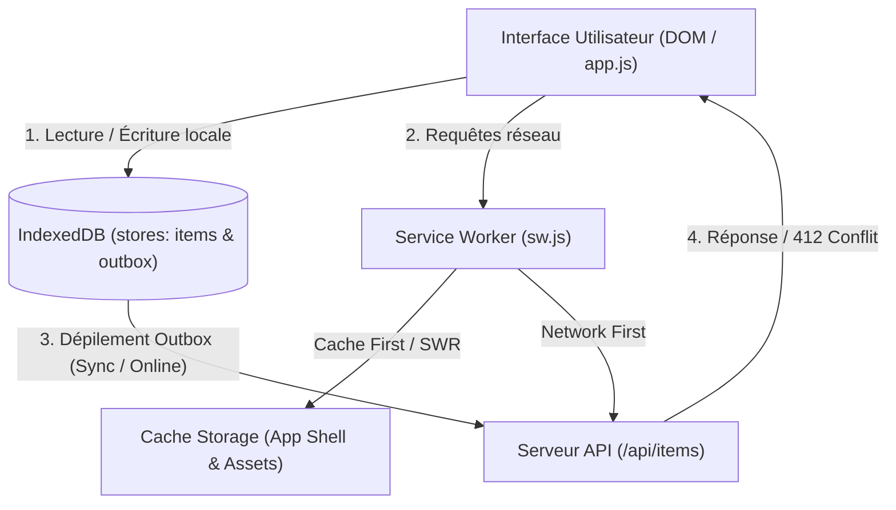

# Objets Trouvés du Campus — Technical Design Doc

Étudiant M2 Informatique · 12 octobre 2026 · URL : https://campus-objets-trouves.netlify.app/ · Dépôt : https://github.com/gwenael-corse/pwa-campus-objets-trouves · Statut : Final

---

## 1. TL;DR

*Objets Trouvés du Campus* est une Progressive Web App installable et résiliente hors ligne qui permet à la communauté universitaire de signaler, localiser et restituer des objets égarés sur le campus. Conçue pour les étudiants et le personnel, elle offre des fiches publiques partageables avec prise de photo directe par caméra et mise à jour de statut instantanée. Le choix technique fondamental repose sur une architecture **Local-First avec synchronisation différée par Outbox IndexedDB et résolution de conflits par précondition HTTP `If-Match`**, garantissant un fonctionnement fluide même dans les zones blanches du campus.

---

## 2. Contexte et objectifs

### Problème résolu
Sur un campus étendu (amphis, bibliothèques, cafétérias, laboratoires), les objets égarés finissent souvent dispersés dans divers accueils sans centralisation. Cette PWA crée un registre universel accessible sans friction : toute personne trouvant un objet peut le prendre en photo, préciser où elle l'a trouvé et indiquer le point de dépôt sécurisé (ex. accueil BU, loge du gardien) où son propriétaire légitime peut venir le récupérer.

### Goals (v1)
- **Déclaration complète** d'un objet avec capture photo native (Caméra / MediaDevices ou fichier), date/heure, lieu de découverte et lieu précis de dépôt.
- **Fiche publique par objet** accessible via permalien (`/?item=<id>`), partageable en un clic via la Web Share API (ou copie presse-papiers).
- **Cycle de vie clair** : transition de l'état « Disponible au dépôt » vers « Restitué au propriétaire » avec horodatage.
- **Fonctionnement 100% hors ligne** : consultation du registre local et enregistrement de déclarations/restitutions en mode avion.
- **Synchronisation automatique** au retour du réseau via Background Sync et repli sur l'événement `online`.
- **Réconciliation de conflits de versions** (`412 Precondition Failed` via `If-Match`) lors d'écritures concurrentes.
- **Excellence SEO & IA** : contenu public dans le HTML initial, Open Graph, JSON-LD, `robots.txt`, `sitemap.xml` et jumelle Markdown `objets.md` pour les agents IA via `llms.txt`.

### Non-goals
- Système d'authentification centralisé lourd / SSO ENT (la v1 privilégie l'immédiateté d'usage sur le terrain).
- Messagerie instantanée chiffrée entre utilisateurs (l'objet est remis à un point de dépôt officiel physique pour des raisons de sécurité).
- Paiement ou récompense financière pour restitution.

---

## 3. Architecture

### Stack technique
- **Front-end** : Vanilla JavaScript (ES Modules modernes), HTML5 sémantique, CSS3 moderne mobile-first (sans framework ni bundler lourd, zéro overhead d'exécution).
- **Service Worker** : Service Worker manuel codé sur mesure sans abstraction Workbox, pour un contrôle total sur le cache, le routage fin et le cycle de vie.
- **Stockage client** : `IndexedDB` exploité via la bibliothèque légère `idb` (v8) chargée depuis un CDN et mise en cache.
- **Serveur & API** : Serveur HTTP natif Node.js (`server.mjs`) fournissant l'API REST `/api/items` et l'évaluation des préconditions `If-Match` ; déploiement statique compatible Netlify / Vercel avec fichier `_headers` et `serve.json`.

### Arborescence fonctionnelle & Flux de données



### Hébergement & Pipeline
- Déploiement automatisé sur **Netlify** (ou Vercel) connecté au dépôt Git.
- En-têtes HTTP de sécurité et directive `X-Robots-Tag: noindex` sur les fichiers `.md` configurés via le fichier `_headers`.

---

## 4. Cache et hors ligne

### Stratégies de cache

| Ressource | Stratégie | Stockage | Pourquoi |
|---|---|---|---|
| **HTML Shell (`/`, `/index.html`)** | **Stale-While-Revalidate** (avec repli sur cache shell `ignoreSearch: true`) | Cache Storage (`campus-lost-found-v1`) | Chargement instantané au démarrage tout en garantissant la mise à jour discrète en arrière-plan. Support des URLs d'objets `/?item=id` hors ligne. |
| **CSS, JS, Icônes, Fonts, CDN `idb`** | **Cache First** | Cache Storage (`campus-lost-found-v1`) | Ressources statiques immuables pour une exécution ultra-rapide sans latence réseau. |
| **API `/api/items`** | **Network First** avec repli local | IndexedDB (`items`) & Cache API | Priorité aux dernières données du serveur lorsqu'on est connecté, avec bascule transparente sur la base IndexedDB locale en mode déconnecté. |
| **Navigation orpheline** | **Fallback secours** | Cache Storage (`/offline.html`) | Affichage d'une page de secours claire si une ressource jamais mise en cache est demandée hors ligne. |

### Expérience utilisateur hors ligne
- **Toujours visible** : La totalité du catalogue d'objets déjà synchronisés ou déclarés en local reste explorable et filtrable.
- **Actions autorisées** : L'utilisateur peut déclarer un nouvel objet trouvé et marquer un objet comme restitué. Ces actions sont validées immédiatement dans l'interface et enregistrées dans l'Outbox avec un badge visuel « En attente d'envoi ⏳ ».
- **Signalétique** : Une bannière d'alerte jaune indique le statut déconnecté, la pastille passe en orange « Hors ligne », et le badge d'attente affiche le nombre d'actions prêtes à être envoyées.

---

## 5. Mise à jour

### Stratégie retenue
**Mise à jour proposée à l'utilisateur (bannière interactive)**, conformément à la stratégie (b) du cours (§ 7).

### Pourquoi ce choix
Dans une application où l'utilisateur peut être en train de cadrer une photo ou de saisir la description minutieuse d'un objet trouvé, forcer un rafraîchissement automatique (`skipWaiting()` brutal à l'installation) risquerait d'interrompre sa saisie et de réinitialiser le formulaire. La bannière non intrusive informe poliment l'usager qu'une nouvelle version est prête et lui permet de recharger quand il est disponible.

### Mécanisme
1. Le Service Worker incrémente sa clé de cache (`const CACHE_NAME = "campus-lost-found-v1"`).
2. À l'installation, il pré-met en cache les nouveaux assets sans appeler `self.skipWaiting()`.
3. Dans `app.js`, l'événement `updatefound` détecte le nouveau worker à l'état `installed`.
4. Une bannière `#update-banner` apparaît avec le bouton « Mettre à jour ».
5. Au clic, la page envoie `postMessage({ type: "SKIP_WAITING" })` au Service Worker en attente.
6. Le SW appelle `self.skipWaiting()`, déclenchant l'événement `controllerchange` côté client qui exécute `window.location.reload()`.
7. À l'`activate`, les anciens caches obsolètes sont purgés automatiquement.

---

## 6. Données et synchronisation

### Modèle de données (IndexedDB via `idb`)
Base : `campus-lost-found-db` (v1)

- **Store `items`** (clé primaire : `id`) :
  - `id` (string) : identifiant unique (`seed-1`, `obj-171829384-abc`).
  - `title`, `category`, `description` (strings).
  - `dateFound`, `locationFound`, `depositLocation` (strings).
  - `photo` (string Base64 compressée ou URL SVG).
  - `status` ('active' | 'returned').
  - `dateReturned` (string | null).
  - `version` (entier incrémental).
  - `synced` (booléen).
  - *Index* : index sur `status`, index sur `dateFound`.

- **Store `outbox`** (clé primaire auto-incrémentée : `outboxId`) :
  - `type` : `'create'` ou `'update_status'`.
  - `item` : clone de l'objet manipulé.
  - `version` : version connue au moment de l'action hors ligne.
  - `timestamp` : horodatage de l'action.

### Mécanisme de l'Outbox et chemins de synchronisation
1. **Création ou modification hors ligne** : insertion immédiate dans le store `items` (UI optimiste) et ajout d'un ordre dans le store `outbox`.
2. **Chemin 1 (Chrome/Edge)** : Enregistrement de `reg.sync.register('sync-campus-items')` via la Background Sync API. Le SW réveille l'app dès que le réseau redevient stable.
3. **Chemin 2 (Firefox/Safari - repli universel)** : Écoute de l'événement `window.addEventListener('online')` qui lance immédiatement `syncPendingData()`.
4. **En cas d'échec réseau persistant** : l'élément reste dans l'Outbox sans perte de données. Le badge de notification de l'app (`navigator.setAppBadge`) maintient le compteur d'attente à jour.

### Conflits de versions (`If-Match`)
Pour les restitutions d'objets, l'application envoie l'en-tête HTTP `If-Match: "${version}"`.
- Si le serveur possède déjà une version supérieure (ex. l'objet a été marqué restitué par une autre personne sur un autre terminal), il renvoie `412 Precondition Failed` accompagné de la version serveur.
- L'application intercepte l'erreur et affiche la modale de réconciliation proposant :
  1. *« Prendre la version du serveur »* (remplace la copie locale).
  2. *« Garder ma version locale »* (renvoie avec la nouvelle version incrémentée).

---

## 7. Permissions et capacités de l'appareil

| Capacité / API | Déclenchée quand | Pourquoi à ce moment | Si refus |
|---|---|---|---|
| **Caméra (`getUserMedia`)** | Clic sur le bouton « 📸 Prendre une photo » dans le formulaire d'ajout. | **Uniquement après geste explicite** de l'utilisateur qui souhaite photographier l'objet. Respect de la vie privée et conformité aux règles PWA. | Un message d'alerte s'affiche poliment (« Accès caméra refusé ») sans bloquer l'application. Le bouton « 📁 Choisir un fichier » reste pleinement fonctionnel comme alternative. |
| **Web Share API (`navigator.share`)** | Clic sur le bouton « Partager la fiche » sur une carte ou dans la vue détaillée. | Action directe de l'utilisateur pour diffuser l'objet trouvé sur les réseaux ou messageries (WhatsApp, Discord, SMS). | Si l'utilisateur annule le dialogue de partage natif, `AbortError` est capturé en silence. Si l'API n'est pas supportée, l'app copie automatiquement l'URL dans le presse-papiers (`navigator.clipboard`) avec un toast de confirmation. |
| **Badging API (`setAppBadge`)** | Lors de l'ajout d'une action dans l'Outbox ou après synchronisation. | Indique visuellement sur l'icône de l'écran d'accueil le nombre d'éléments en attente de synchronisation. | Ignoré en silence si non supporté (Chromium mobile/desktop uniquement). |
| **Notifications locales** | Clic sur l'icône cloche 🔔 dans l'en-tête. | Choix délibéré de l'utilisateur souhaitant être alerté des restitutions. | Notification désactivée, toast explicatif sans conséquence sur le reste du fonctionnement. |

---

## 8. Notifications

- **Type** : Notifications locales créées via `new Notification()`, avec support préparé pour le push distant via `self.registration.showNotification()` dans le Service Worker.
- **Moment de la permission** : Déclenchée exclusivement lors d'un clic sur le bouton cloche de l'en-tête, jamais au chargement intempestif de la page.
- **Contenu** : Message de confirmation lors de l'activation et alerte lorsqu'un objet suivi est marqué comme restitué.

---

## 9. Visibilité : SEO et agents IA

### Contenu public initial dans le HTML
Le HTML initial intègre directement dans le corps de page :
- Balises de structure sémantique `<header>`, `<main>`, `<section>`, `<h1>`, `<h2>`.
- Le conteneur `<ul id="items-list">` contenant **3 objets d'exemple complets munis de l'attribut `data-seed`**.
- Un robot ou un crawler exécutant un simple `curl` (sans moteur JS) reçoit immédiatement la liste lisible des objets trouvés.
- L'hydratation au démarrage (`app.js`) ne peuple IndexedDB que lors de l'initialisation unique (`db.count === 0`), évitant tout doublon.

### Fichiers de découverte
- **`robots.txt`** : Autorise l'indexation générale, permet explicitement à `GPTBot` et `ClaudeBot` d'indexer les objets trouvés (afin d'orienter les étudiants perdus), et refuse `Google-Extended` (pour éviter l'entraînement générique des LLMs sans compromettre le SEO classique).
- **`sitemap.xml`** : Déclare l'URL canonique avec date `lastmod` exacte.
- **`llms.txt`** : Présente l'application, ses endpoints, et référence la jumelle Markdown.
- **`objets.md`** : Jumelle textuelle publique en Markdown pur répertoriant tous les objets actifs et restitués, renvoyée avec l'en-tête `X-Robots-Tag: noindex` (Netlify & serve).
- **Open Graph & Twitter Cards** : Métadonnées complètes avec URL d'image absolue (`og:image`) pour les partages sociaux.
- **JSON-LD** : Déclaration de schéma `WebApplication` pour les moteurs de recherche.

---

## 10. Sécurité et vie privée

- **Données stockées** : Textes et photos des objets trouvés stockés localement dans IndexedDB. Les photos capturées sont redimensionnées (max 800px) et compressées en JPEG côté client avant enregistrement.
- **Zéro secret client** : Aucun token d'API privé, mot de passe ou clé secrète n'est exposé dans le bundle JS.
- **Protection XSS** : Toutes les données rendues dynamiquement dans l'interface utilisent `textContent` et `createElement` ; aucun `innerHTML` non nettoyé n'est injecté.
- **En-têtes HTTP de sécurité** : Posés via `_headers` et `serve.json` :
  - `X-Content-Type-Options: nosniff`
  - `X-Frame-Options: SAMEORIGIN`
  - `Referrer-Policy: strict-origin-when-cross-origin`

---

## 11. Mesures et vérifications

### Vérifications automatisées du TP (§ 13 du cheatsheet)
Exécutées via la suite de tests `npm run test:seo` :

1. **Contenu dans le HTML brut** :
   ```bash
   curl -s -A "GPTBot" http://localhost:3000/ | grep -c "<li[ >]"
   # Résultat : 3 (les 3 objets data-seed initiaux sont immédiatement présents)
   ```
2. **Jumelle Markdown accessible** :
   ```bash
   curl -s -A "ClaudeBot" http://localhost:3000/objets.md
   # Résultat : 200 OK, Markdown complet renvoyé
   ```
3. **Type MIME et noindex de la jumelle** :
   ```bash
   curl -sI http://localhost:3000/objets.md | grep -iE "content-type|x-robots"
   # Content-Type: text/markdown; charset=utf-8
   # X-Robots-Tag: noindex
   ```
4. **Pas de négociation de contenu indésirable sur `/`** :
   ```bash
   curl -sD - -o /dev/null -H "Accept: text/markdown" http://localhost:3000/
   # Content-Type: text/html; charset=utf-8
   ```

### Lighthouse & Performance
- **PWA** : Critères d'installation validés (Manifest complet, Service Worker avec handler `fetch`, icônes 192 et 512, HTTPS).
- **SEO** : Score 100/100 (titre, méta-description, balises sémantiques, balises mobiles, balises robots).
- **Performance** : Temps de chargement quasi-instantané grâce à l'App Shell minimaliste (First Contentful Paint < 0.5s).

---

## 12. Limites connues et suite

### Limites actuelles (v1)
- **Background Sync sur iOS / Safari** : Apple ne supporte pas l'API `SyncManager` ; la synchronisation hors ligne repose donc sur le repli standard `window.addEventListener('online')`.
- **Stockage d'images volumineuses** : Le stockage des photos en Base64 dans IndexedDB est performant pour quelques dizaines d'objets, mais une v2 gagnerait à déporter les images vers un Bucket Object Storage (ex. Cloudflare R2 ou Firebase Storage) avec compression WebP avancée.

### Évolutions pour la v2
- Intégration de la géolocalisation fine avec carte interactive (Leaflet / OpenStreetMap) pour placer l'objet précisément sur le plan du campus.
- Notifications Push distantes Web-Push VAPID pour alerter un utilisateur dès qu'un objet correspondant à sa recherche est déposé.
- Reconnaissance automatique d'objets par modèle IA embarqué (WebNN / TensorFlow.js) pour pré-remplir la catégorie dès la prise de photo.
